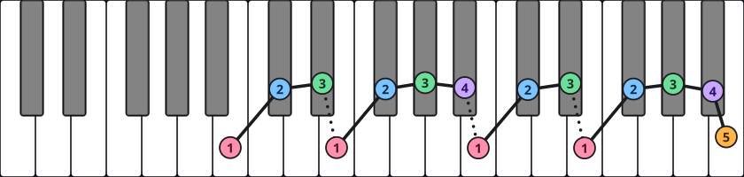

# Piano fingerings

Major and minor scale fingerings for dyslexic people: each finger has its own color, so they're easier to tell apart than plain numbers. 

You can view it at [polymeilex.github.io/piano-fingerings/](https://polymeilex.github.io/piano-fingerings/)

Initially based on charts from [piano-ology.com](https://piano-ology.com/), that I adjusted for my brain's needs
